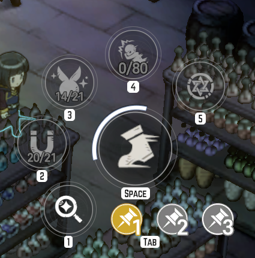
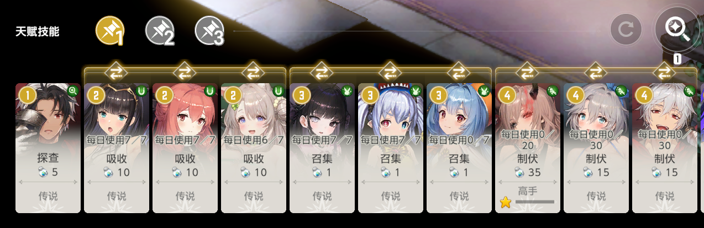

## 01 开始前准备

将**探查、吸收、召集、制服、生成魔法阵**按图示顺序放入**技能组 1**，分别对应第 1～5 个位置。

**目前除第 6 章外，其余全部地图均可跑。**

## 02 第一次怎么运行

1. 打开「启用」和「执行地图采集」。
2. 想先试一张：打开「自定义采集关卡」，只勾选一张已解锁的卡带，并打开「单章模式」。
3. 根据需要选择是否启用压制，核对「采集卡带屏蔽」中没有本次目标。
4. 返回游戏主页，点击任务旁的「开始」。
5. 在运行状态中查看目标卡带、采集进度和技能次数；结束后查看任务卡上的结果。

## 03 选项怎么选

**自定义采集关卡**：关闭时按支持的剧情、角色与活动卡带范围执行；开启时只处理下方勾选的卡带。剧情第 6 章不参与采集。

**单章模式**：本次新完成一张卡带后停止，不代表永远固定采集同一张。要固定目标，请同时使用自定义关卡。

**采集卡带屏蔽**：被屏蔽的卡带不会执行，即使已经勾选。可填写卡带名或类别编号，例如 `Story_3, Character_2, Event_4`。

**启用压制技能**：开启时按路线执行压制；关闭后执行吸收与召集。之后重新开启压制，可继续核验尚未完成的动作。

识别阈值、加载等待和重试次数建议先保持默认。发生异常时，先保留问题报告，再判断是否需要调整。

## 04 完成与续跑

**资源每周一 08:00 刷新，技能次数每日 08:00 刷新，均为北京时间。** 剩余次数以游戏内识别结果为准。

- **今日额度已用尽**：当前可用技能额度不足，本周采集可能仍有剩余，可在下一次刷新后继续。
- **本周跑图已完成**：当前所选范围已经完成；修改卡带范围或压制选项后，会按新配置重新判断。
- **中途停止或失败**：保留已有进度，下次启动继续核验未完成部分；不要为了续跑而删除配置或进度文件。
- **活动卡带未找到**：在活动卡页未找到的卡带会按未持有跳过，不影响当前范围的完成判断。

## 05 常见问题

**勾选了卡带，为什么没有进去？**

依次检查卡带屏蔽、本周已完成进度和剩余技能次数；单章模式也会在新完成一张后结束。

**找不到技能或传送入口怎么办？**

先确认游戏内技能配置、地图解锁情况，以及画面是否被弹窗、队友或悬浮窗挡住。保留失败现场，在「截图方式」页生成问题报告。

**是否需要每天重新配置？**

通常不需要。保持需要的范围，下次运行会结合已有进度和当日额度继续处理。
