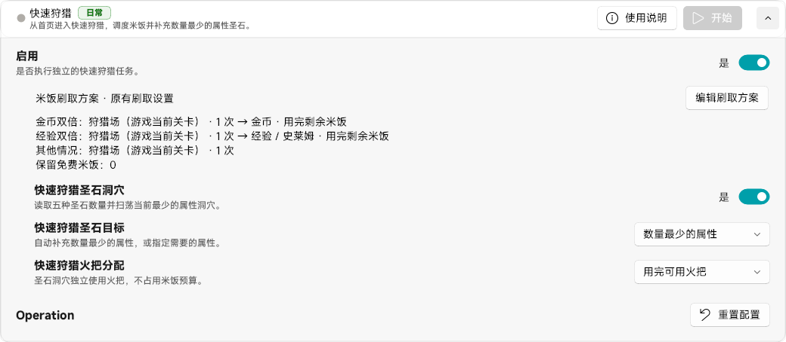

## 01 开始前准备

**先用方案里的「模拟执行预览」确认米饭分配。** 预览只展示计划，点击任务的「开始」才会实际运行。

从游戏主页开始，确保快速狩猎和目标关卡已经解锁。狩猎场沿用游戏当前选择的关卡，运行前请先在游戏里选好。

*点击图片放大。当前版本通过「编辑刷取方案」安排米饭用途。*

## 02 第一次怎么运行

1. 展开「快速狩猎」，点击「编辑刷取方案」。
2. 选择或调整方案，设置保留的免费米饭与执行步骤。
3. 在「模拟执行预览」里选择金币、经验是否双倍及米饭数量，核对结果后保存。
4. 按需启用圣石洞穴，设置圣石目标和火把分配。
5. 返回游戏主页，点击任务旁的「开始」。

## 03 方案怎么执行

规则按从上到下的顺序匹配，**只执行第一条满足条件的规则**；没有匹配规则时执行默认步骤。

每条规则中的步骤按顺序运行，可分配给狩猎场、金币或经验。单次消耗 6 米饭，不足一次的余量保留；设置的免费米饭保留量也会生效。

方案可以复制、重命名，并切换当前使用的方案。运行或排队期间如需保存变更，请先停止任务。

## 04 圣石与消耗

米饭方案与圣石洞穴分别配置。圣石洞穴会结合属性库存和所选策略处理火把，运行前请确认目标与分配方式。

程序会确认免费资源开关及消耗信息；识别结果不明确时可能安全停止。请查看运行状态中的米饭、火把、当前阶段和结果。

## 05 常见问题

**为什么没有刷我想要的狩猎场？**

脚本沿用游戏当前选择的狩猎场。请先在游戏里选择目标，再开始任务。

**为什么第二条规则没有执行？**

规则是按优先级选择，第一条匹配后不会再执行后续规则。需要连续刷取多个目标时，把它们加入同一条规则的步骤。

**预览和实际次数不同？**

预览使用手动填写的双倍状态和米饭数量，实际运行使用游戏识别结果，并遵守资源保留量。出现异常时保留现场并生成问题报告。
