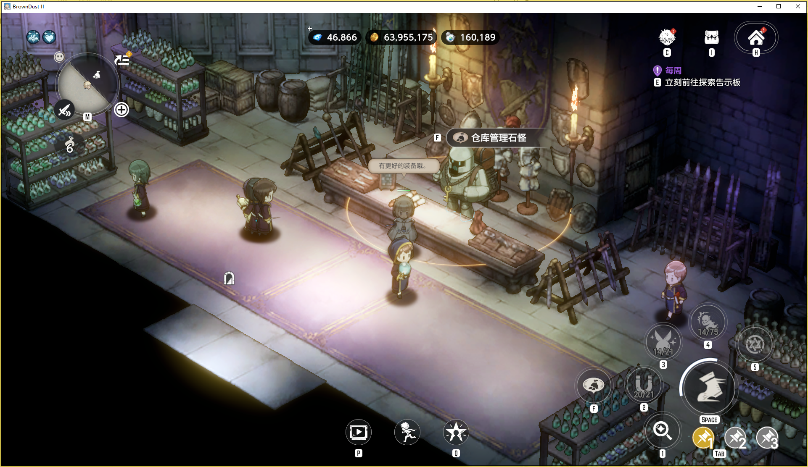
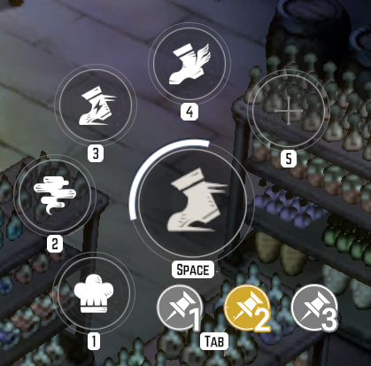
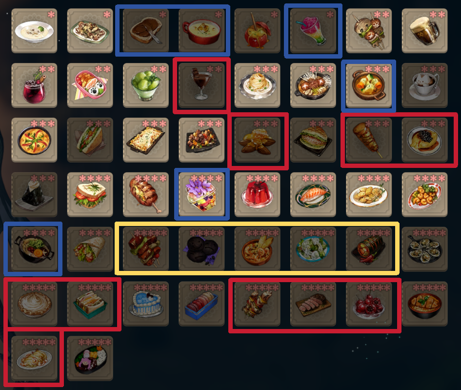

## 老手须知

1. **固定角色位置**：请确保角色在第 6 章卡带中的停留位置为「施塔因之塔仓库」内，具体位置见图一。

2. **设置料理技能**：将「料理」天赋技能放在**第二组技能栏**中，组内具体位置不限，设置示例见图二。

3. **购买与制作**按跑图和战斗能补充食材的情况配置。重建收藏时，脚本按 31 张卡带核对收藏，包含剧情 3 的蘑菇，排除剧情 3、13、16 的虾，剧情 9 留空。

## 新手须知

跑商需要先解锁全部卡带。想通过料理和跑商获得收益，还需要完成以下准备：

- 将图三所示的**砍价技能练至传说等级**。

- 将图四所示的**料理制作技能练至传说等级**。

- 尽量收集齐图五所示的食谱，跑商需要用到其中几乎全部食谱。

- 通过跑图和战斗补充虾仁等食材。自行维护游戏内收藏时，可将**收藏重建周期**设为**永不**。

## 料理和库存设置

- **黄框料理**优先做 5 道，接着做 10 道**红框料理**，最后做 6 道**蓝框料理**。默认全选，同色按图五中从上到下、同排从左到右的顺序执行。取消全部食谱会跳过料理。
- 每一批都核对详情、MAX、制作结果和返回列表。同一道料理还能制作时继续做，变灰后再做下一道。
  **单道料理批次上限**默认 20 批，达到上限时仍可制作会报告未完成。
- 随程序附带的新版出售价表按有效市场日期从 2026 年 11 月 19 日启用，即北京时间 11 月 18 日 23:00。
- **商品保留量**每行写完整商品名和数量，例如 `杏仁=5000`；`豆子=-1` 表示全部保留。
  未填写的商品沿用价表保留量。该设置不会使不在最高价表内、标记为不出售或被黑名单
  排除的商品进入出售流程。格式错误时停止出售。
- 出售跨过23:00刷新点时，停止旧价表的后续商品和最终出售确认；重新执行会加载新日期价表。
