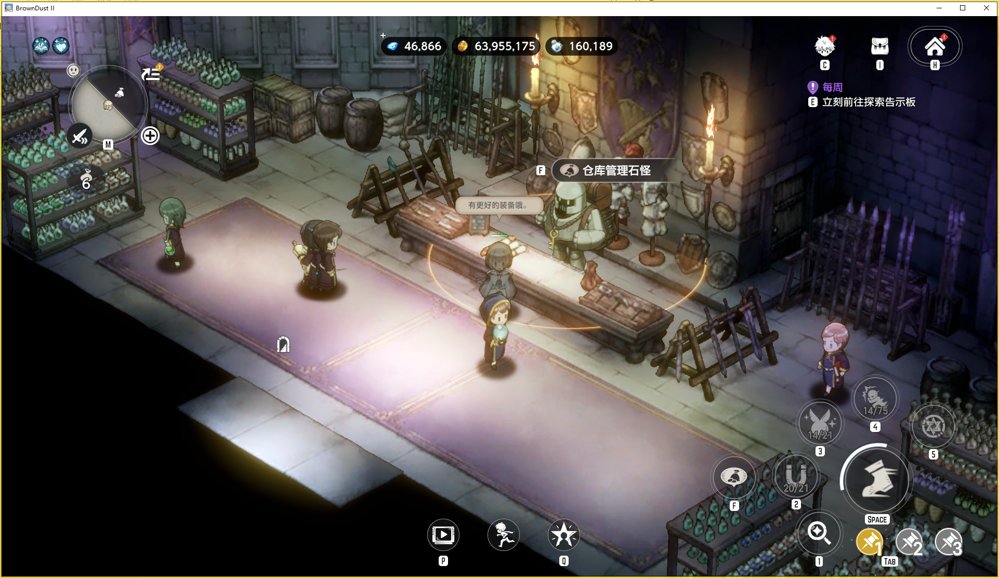
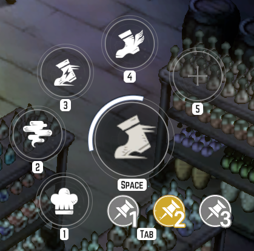
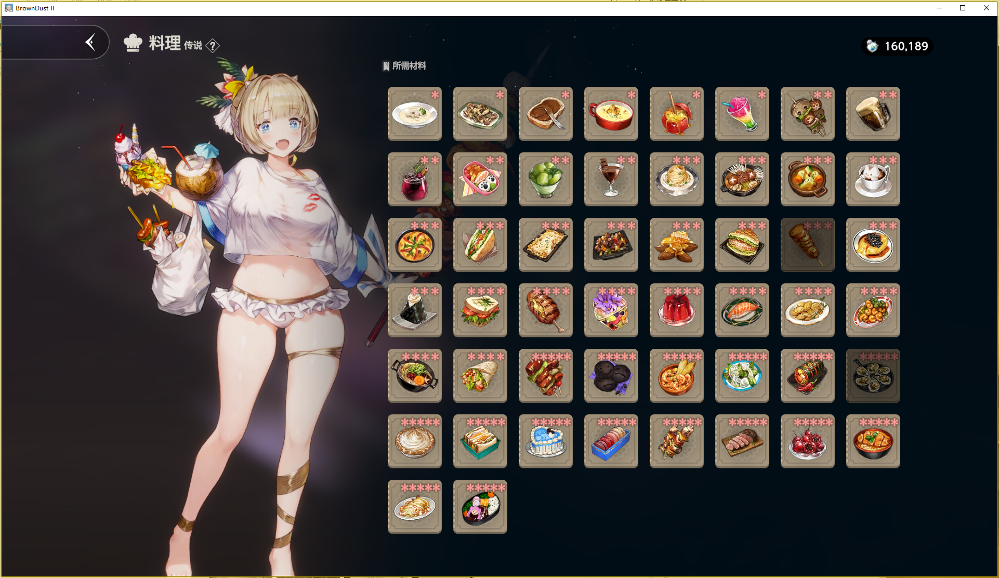

## 老手须知

1. **固定角色位置**：请确保角色在第 6 章卡带中的停留位置为「施塔因之塔仓库」内，具体位置见图一。

2. **设置料理技能**：将「料理」天赋技能放在**第二组技能栏**中，组内具体位置不限，设置示例见图二。

3. **制作与买卖策略**：料理制作、商品购买和出售策略按这篇 [Wiki 跑商攻略](https://www.gamekee.com/zsca2/712120.html)执行。

## 新手须知

跑商需要先解锁全部卡带。想通过料理和跑商获得收益，还需要完成以下准备：

- 将图三所示的**砍价技能练至传说等级**。

- 将图四所示的**料理制作技能练至传说等级**。

- 尽量收集齐图五所示的食谱，跑商需要用到其中几乎全部食谱。

- 配合**跑图功能**收集材料，再结合上述 Wiki 的策略进行料理制作与商品买卖。
