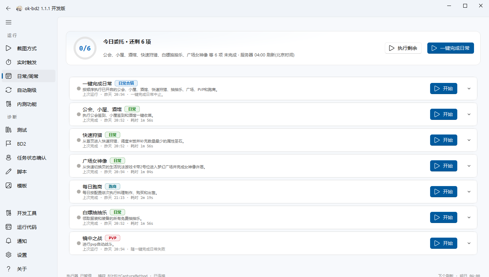

# ok-bd2

基于 [ok-script](https://ok-script.com/) 框架的 **BrownDust II Windows PC 自动化辅助工具**。

支持自动登录、日常任务、快速狩猎、PVP、跑商、装备日常、任务领奖、主线探索和每周地图采集，通过图像识别与鼠标操作执行任务。

[下载安装包](https://github.com/GodRaymond233/ok-bd2/releases){ .md-button .md-button--primary }
[安装与完整使用说明](https://github.com/GodRaymond233/ok-bd2/blob/main/README.md){ .md-button }

## 开始使用

1. 使用 Windows 10 / 11 和 BrownDust II PC 客户端，将游戏设置为 16:9、FHD 画质。
2. 下载 Releases 中的 `setup.exe` 安装包，按 README 完成运行前检查。
3. 在程序中配置并运行任务；遇到异常时，使用“生成问题报告”保留现场。

## 使用指南

- [快速狩猎](guides/quick-hunt.md)
- [每日跑商](guides/trade.md)
- [每周跑图](guides/collection.md)
- [装备分解与精炼](guides/equipment-daily.md)
- [每日及每周奖励](guides/mission-rewards.md)
- [推主线与快速探索](guides/main-story.md)

## 社区与反馈

- QQ 群：**玩家集结社｜棕尘2**（群号：`1081236717`）— [点击链接加入群聊](https://qm.qq.com/q/VYXd1fHUAM)

{ width="240" }

!!! warning "使用前请阅读免责声明"

    本项目是免费的开源外部辅助工具，与游戏开发商和发行商没有从属或授权关系。
    自动化可能违反游戏或平台服务条款，使用者需自行承担账号、数据及收益风险。
    完整声明见 [README](https://github.com/GodRaymond233/ok-bd2/blob/main/README.md#免责声明)。
